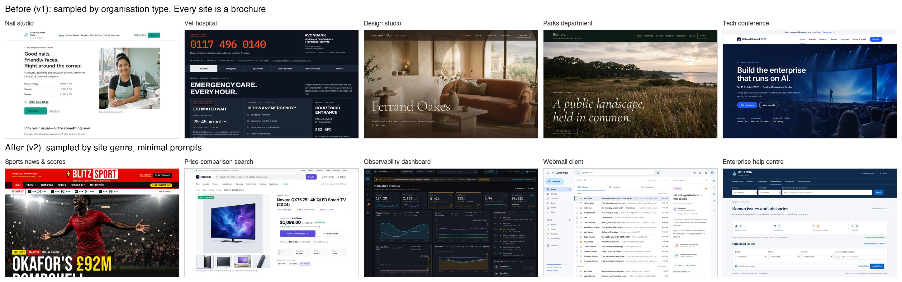

# Site taxonomy v2: sampling by site genre, not by organisation

## Why v1 had to change

v1 (`sitegen/taxonomy.json`) sampled the **organisation that owns the site**: 23 classes such as "Beauty & personal
care / nail studio" or "Government / parks department". The 10 sites built from it were polished and covered 10
industries, but structurally they were all one kind of site: an organisation's brochure. Each had a top nav, a hero,
stat strips, 3–4 column card grids, a call-to-action band and a 4-column footer, and every site had exactly 6 pages.
Nothing resembled the sites people actually use most: search engines, mega-retailers, social feeds, video platforms,
webmail.

Two causes:

1. **The axis.** Who owns a site says little about its interface. A vet and a law firm get the same template.
2. **The style step.** It asked Opus for 5 directions "spread as widely as possible" and allowed at most one "clean
   modern" look. That cap had been added in v1 to stop every site coming out white with one blue accent, but it pushed
   4 of 5 options towards deliberately unusual looks. A short-video app came out as a brutalist DIY collective; a
   rental platform as a regional cabin almanac.

## How v2 works

Sampling is unchanged: **class → subclass → 5 style directions from Opus → pick one at random**. The generator still
alternates Opus / Sol by seed. Three things changed:

**1. Classes are site genres** (`sitegen/taxonomy_v2.json`): 14 classes, 79 subclasses. Each subclass has a one-line
note on its typical pages and components, which the style prompt receives.

| Class | Example subclasses |
|---|---|
| Search engine & web portal | web search, vertical search, portal, map search, directory |
| E-commerce store | mega-retailer, single-brand, specialty, grocery, price comparison |
| Classifieds & listings | classifieds, property portal, job board, used cars, resale/auction, freelance |
| Booking & reservations | travel agency, airline, stays, restaurants, ticketing, appointments |
| News & magazine | national, broadcaster, sports, financial, magazine, local |
| Social network & feed | general, photo-first, microblog, professional, short video |
| Forum, Q&A & community | link aggregator, bulletin board, Q&A, support community, fan wiki |
| Video, audio & media | video sharing, film/TV streaming, music/podcast, live streaming, stock media |
| Webmail & messaging | webmail, team chat, messenger, calendar |
| Web app / dashboard (logged in) | analytics, CRM, kanban, code hosting, back office, banking, AI assistant, learning |
| Self-service public & utility portal | government hub, city services, utility account, transit, patient portal |
| Reference, docs & learning | wiki, technical docs, help centre, recipes, course marketplace, dictionary |
| Blog, personal & creator | blog, newsletter, portfolio, academic homepage, creator hub |
| Organisation brochure | local business, hospitality, corporate, SaaS marketing, nonprofit, school, venue, practice, event microsite |

All of v1 lives on as subclasses of "Organisation brochure".

**Grounding.** The genre axis follows published classifications of web sites by *function* rather than topic:
- web-genre corpora: Santini's 7 genres (blog, e-shop, FAQ, newspaper front page, listing, personal home page, search
  page); Meyer zu Eissen & Stein's KI-04; Shepherd & Watters' "cybergenres" (content, form, functionality)
- the site-genre patterns of van Duyne, Landay & Hong, *The Design of Sites*, and Welie's site-type patterns
- the interface-genre choices of agent benchmarks (WebArena, VisualWebArena) and of Vision2Web

Genres the academic corpora predate (social feeds, video platforms, webmail) are grounded in Ruth et al., *A World
Wide View of Browsing the World Wide Web* (IMC 2022), whose data puts search engines, video sharing and social networks
among the most-visited sites in nearly every country studied, and in industry URL-filter categories (Cloudflare,
FortiGuard). Booking and public-service portals are listed by the sources as verticals; we promote them to genres
because their interfaces are distinctive. The full list of ~40 sources with category lists is in
`out/ontology_research.json`.

**2. Classes are drawn without replacement.** Seeds are cut into blocks of 14; each block is one shuffled pass over
all classes. So any 10 consecutive seeds inside a block give 10 different classes, and a 14-seed batch covers every
class once. Subclasses stay uniform within the class. v1 still draws each seed independently.

**3. Styles must be likely, not unusual.** The style prompt now asks for 5 looks that real sites of this type commonly
have today, differing only in the ways real sites of the type differ. The "spread widely" instruction and the
"clean modern" cap are gone. For event ticketing this now gives a mainstream marketplace, a nightlife gig app, a
community events platform, a stadium box office and a theatre box office: five looks you would actually find.

## Where things live

| What | Where |
|---|---|
| v2 taxonomy | `sitegen/taxonomy_v2.json` (v1 untouched in `sitegen/taxonomy.json`) |
| Sampler | `sitegen/taxonomy.py`, `sample_site_type(seed, version)` |
| Style prompt | `sitegen/styles.py` (shared by v1 and v2) |
| Run | `python -m sitegen.cli --taxonomy v2 --out out/v2/sites --seeds 1 2 ... [--specs-only]` |
| Outputs (gitignored) | `out/v2/specs/` (current), `out/v2/specs_old/` (before the style change), `out/v2/sites/` |

## First 10 specs (seeds 1–10)

| Seed | Class / subclass | Picked style | Generator |
|---|---|---|---|
| 1 | Booking / event ticketing | Friendly Community Events | Sol |
| 2 | Creator / link-in-bio + shop | Warm Editorial Creator | Opus |
| 3 | Reference / help centre | Enterprise Support Portal | Sol |
| 4 | News / sports news & scores | Bold Red Tabloid | Opus |
| 5 | Webmail / webmail client | Consumer Material Light | Sol |
| 6 | Search / vertical search | Clean Product Comparison | Opus |
| 7 | Forum / product support community | Friendly Consumer Help | Sol |
| 8 | E-commerce / specialty retailer | Minimal Boutique Curation | Opus |
| 9 | Brochure / software marketing site | Clean SaaS Blue | Sol |
| 10 | Web app / analytics dashboard | Dark Observability Console | Opus |

## Minimal build prompts

The site-building prompts (`sitegen/prompts.py`) were also cut down to the essentials. They had grown to about 900
words of rules per call, most of them written for brochure sites: header and footer instructions, an app-shell special
case, one call-to-action band, copy-length and density coaching, and long layout, CSS and copy rule lists, each added
after a defect on some v1 site. Those rules would have pushed every v2 genre back towards a brochure. The prompts now
give only:

- **Brief:** plan a believable site of this type in this style. Pick 5–8 pages a real one has, write concrete
  content, keep shared facts consistent, aim for 3–6 screens per page, and plan up to 30 images with no text in them.
- **Design system:** `styles.css`, plus the markup that goes before and after each page's `<main>`.
- **Page:** build this page with its planned content and images.
- **Five technical constraints** the renderer and grader need: static HTML and CSS only; no external resources; only
  the provided fonts and images; everything visible on load; never say the site is fictional.

Design decisions (navigation, chrome, layout, density, voice) are left to the generator. Rendering defects are still
caught by QC and fixed by the repair rounds; their prompts are unchanged.

## First build (seeds 1–10)

Built with `python -m sitegen.cli --taxonomy v2 --out out/v2/sites --seeds 1 ... 10`:

| Seed | Site | Pages | Images | QC defects before repair → left |
|---|---|---|---|---|
| 1 | Gatherlane: event ticketing, Eventbrite-like | 7 | 20 | 0 → over height budget by 135px on one page |
| 2 | Ines Calder: creator hub | 6 | 24 | 3 → 0 |
| 3 | Asteron Networks: enterprise help centre (downloads, known issues, tickets) | 8 | 10 | 5 → 0 |
| 4 | BLITZ SPORT: sports tabloid with scores and tables | 7 | 28 | 5 → 0 |
| 5 | Luma Mail: Gmail-like webmail client | 5 | 0 | 2 → 0 |
| 6 | Pricetrail: price-comparison search | 7 | 30 | 17 → 1 warning (an image used twice) |
| 7 | Mellow Home: support community | 7 | 15 | 0 → 1 warning (an image used twice) |
| 8 | Oake & Ledger: premium stationery shop | 7 | 28 | 0 → 0 |
| 9 | Avenlo: SaaS marketing site | 7 | 15 | 2 → 0 (5 planned images unused) |
| 10 | Lumen Ops: observability dashboard | 7 | 6 | 30 → 19 text collisions in one table, plus an image used twice |

None of the 176 images needed a placeholder fallback. Pages per site now vary from 5 to 8 (every v1 site had exactly
6). Open issues:
- the dashboard's dense alerts table (s0010), whose text collisions repair did not clear
- the random style pick sometimes chooses the small version of a genre (a boutique shop rather than a mega-retailer)
